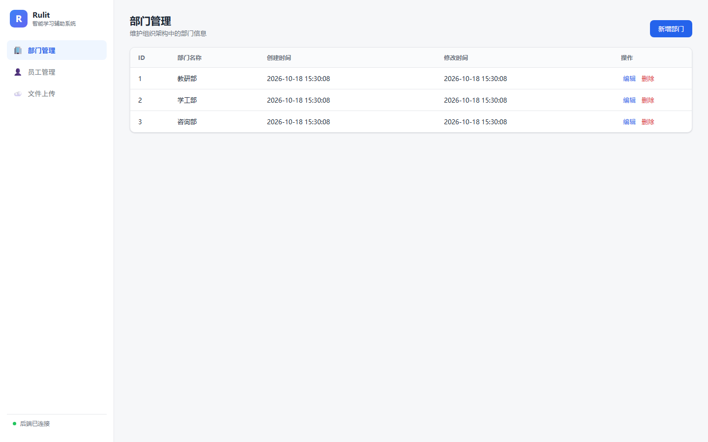
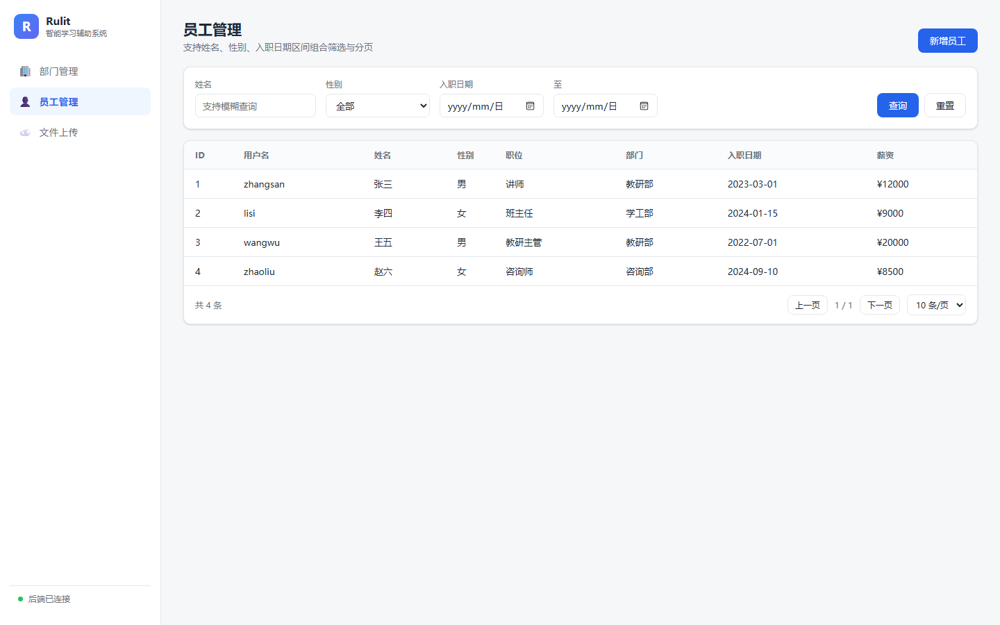

# Rulit 智能学习辅助系统


> **实训作品声明**：本项目为《Java 后端开发》课程实训作品，在实训任务书的基础上完成。后端沿用课程教学案例的工程结构，前端管理界面、数据库初始化脚本、接口整理与文档为本人独立补充。

## 项目预览

| 部门管理 | 员工管理 |
|---|---|
|  |  |

> 截图来自本地实际运行（MySQL 8.0 + Spring Boot 3.4.7），数据为演示数据。

## 项目简介

Rulit 是一个面向教育培训机构的内部管理系统：管理组织架构（部门）与人员（员工），支持员工的分页条件查询、工作经历关联、头像上传。

系统为前后端一体的单仓库结构：Spring Boot 提供 REST 接口，静态页面直接由 Spring Boot 托管，**启动后访问 `http://localhost:8080/` 即可使用**，无需单独部署前端。

## 功能

**部门管理**

- 部门列表、按 ID 查询、新增、修改、删除

**员工管理**

- 分页查询（PageHelper），支持姓名模糊、性别、入职日期区间组合筛选
- 新增员工（含工作经历批量插入，事务控制）
- 列表联表返回部门名称（`deptName`）

**文件上传**

- 上传文件到阿里云 OSS，返回可访问 URL（可选功能，未配置 OSS 时不影响其他接口）

**前端管理界面**

- 单页应用：侧边栏切换部门 / 员工 / 上传三个模块
- 部门：表格 + 新增/编辑弹窗 + 删除确认
- 员工：组合条件筛选 + 分页表格 + 新增弹窗 + 部门下拉
- 上传：点击或拖拽选择文件，展示返回地址
- 支持 `/#emp`、`/#upload` 直达指定视图

## 技术栈

| 层次 | 技术 |
|---|---|
| 后端框架 | Spring Boot 3.4.7（Java 17） |
| 持久层 | MyBatis 3.0.4 + PageHelper 1.4.7 |
| 数据库 | MySQL 8 |
| 工具 | Lombok、Logback |
| 文件存储 | 阿里云 OSS SDK 3.17.4（可选） |
| 前端 | 原生 HTML + CSS + JavaScript（零依赖、无构建） |

## 目录结构

```
rulit-learning-system/
├── pom.xml
├── sql/
│   └── schema.sql                    # 建库建表 + 示例部门数据
├── docs/images/                      # 运行截图
└── src/
    ├── main/
    │   ├── java/com/brucebility/rulit/
    │   │   ├── RulitApplication.java
    │   │   ├── controller/           # DeptController / EmpController / UploadController
    │   │   ├── service/              # 业务接口与实现
    │   │   ├── mapper/               # MyBatis Mapper 接口
    │   │   ├── pojo/                 # 实体、EmpQueryParam、Result、PageResult
    │   │   └── utils/                # 阿里云 OSS 工具类
    │   └── resources/
    │       ├── application.yml
    │       ├── com/brucebility/rulit/mapper/   # Mapper XML
    │       ├── logback.xml
    │       └── static/               # 前端：index.html + css/ + js/
    └── test/
```

## 快速开始

**1. 建库**

```bash
mysql -u root -p < sql/schema.sql
```

脚本会创建 `rulit` 数据库、三张表与 3 条示例部门数据。

**2. 配置数据库（环境变量，推荐）**

```powershell
$env:DB_HOST="127.0.0.1"
$env:DB_PORT="3306"
$env:DB_NAME="rulit"
$env:DB_USERNAME="root"
$env:DB_PASSWORD="你的密码"
```

也可以直接改 `src/main/resources/application.yml`，但**不要把真实密码提交到仓库**。

**3. 启动**

```bash
mvn spring-boot:run
```

或者打包后运行：

```bash
mvn -DskipTests package
java -jar target/rulit-0.0.1-SNAPSHOT.jar
```

**4. 打开界面**

浏览器访问 http://localhost:8080/

**5. 文件上传（可选）**

需设置 `OSS_ACCESS_KEY_ID` / `OSS_ACCESS_KEY_SECRET`，并修改 `AliyunOSSOperator` 中的 `endpoint`、`bucketName`、`region` 为自己的 Bucket。

## 接口一览

| 方法 | 路径 | 说明 |
|---|---|---|
| GET | `/depts` | 部门列表 |
| GET | `/depts/{id}` | 按 ID 查询部门 |
| POST | `/depts` | 新增部门 |
| PUT | `/depts` | 修改部门 |
| DELETE | `/depts?id=` | 删除部门 |
| GET | `/emps?page=&pageSize=&name=&gender=&begin=&end=` | 员工分页查询 |
| POST | `/emps` | 新增员工 |
| POST | `/upload` | 上传文件到 OSS |

统一返回结构：`{ "code": 1, "msg": "success", "data": ... }`（`code=1` 成功，`code=0` 失败）。

## 已验证

- `mvn -DskipTests package` 构建通过（Spring Boot 3.4.7 / Java 22 运行）
- 本地 MySQL 8.0 建库后启动成功，Tomcat 监听 8080
- 接口实测：部门列表返回 3 条、员工新增 4 条后分页查询 `total=4` 且 `deptName` 联表正确
- 前端页面实际加载并截图（见上方预览）

## 说明

- `sql/schema.sql` 的表结构依据实体类与 Mapper 语句还原，字段长度可按实际业务调整。
- 仓库不含 `target/`、`.idea/` 等构建与 IDE 产物。
- 前端为原生实现，不依赖 npm / 构建工具，修改后刷新即可生效。
